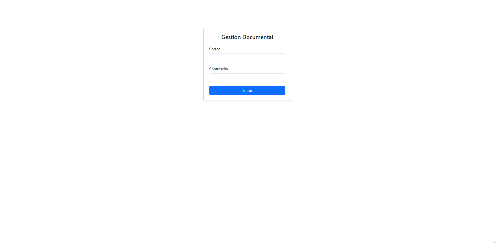
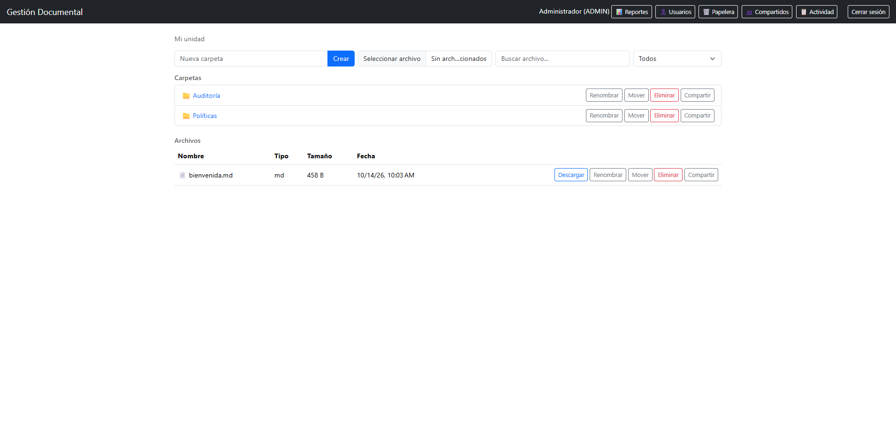
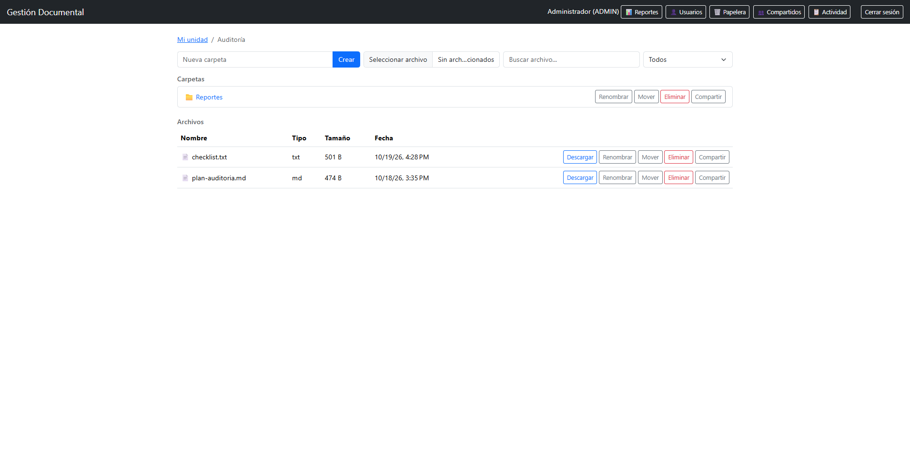
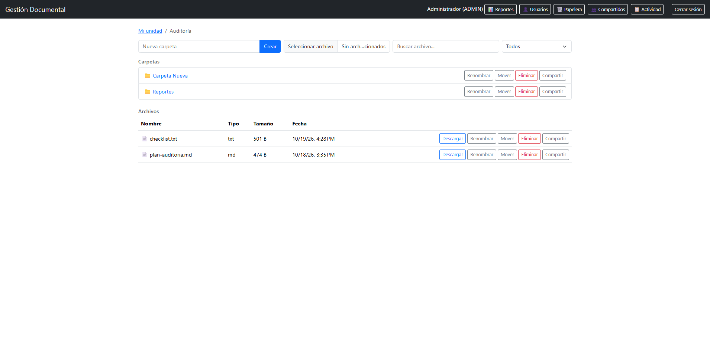
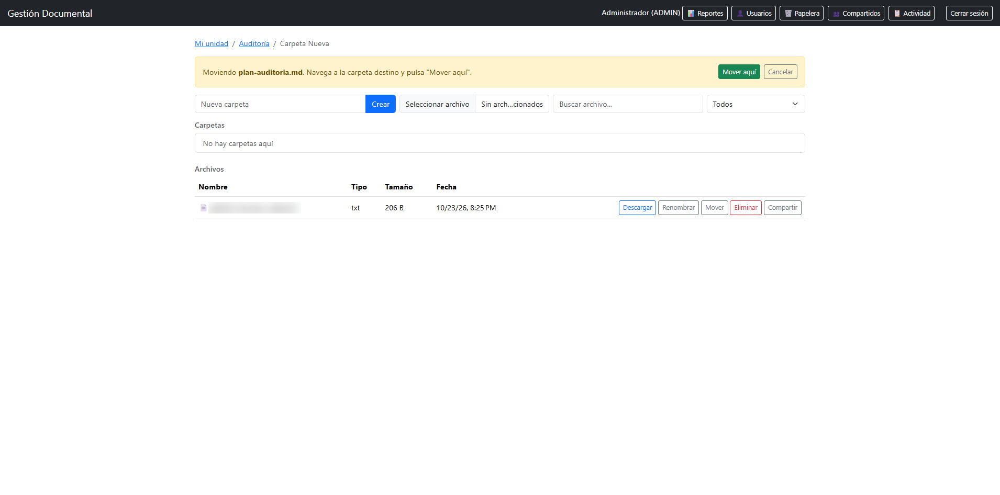
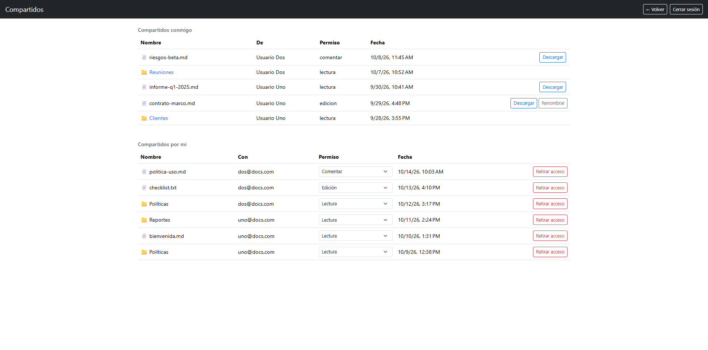
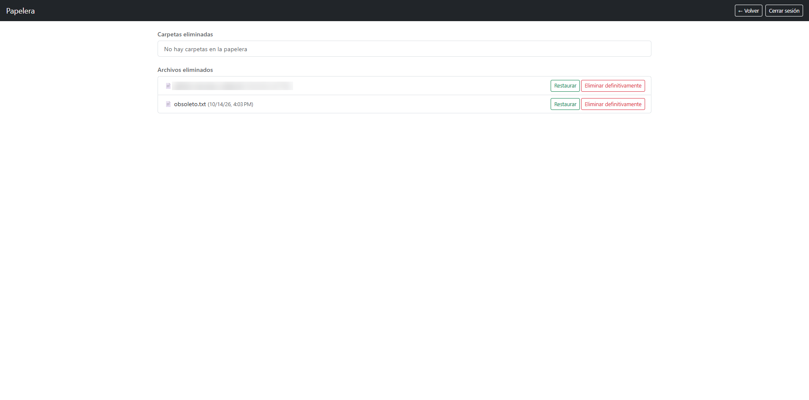
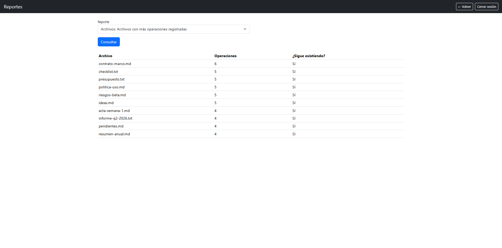
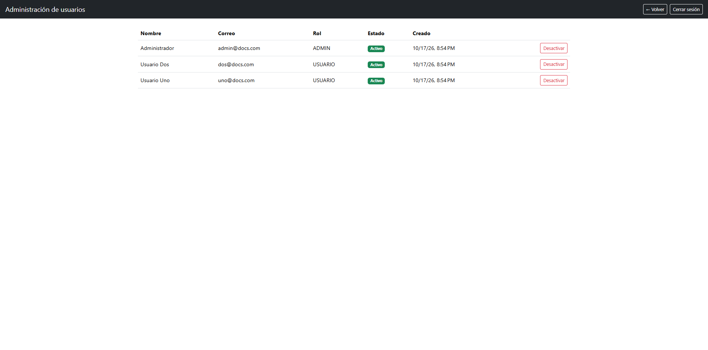

# Manual de Usuario — Sistema de Gestión Documental

**Universidad de San Carlos de Guatemala**
Centro Universitario de Occidente · División Ciencias de la Ingeniería
Ingeniería en Ciencias y Sistemas · Manejo e Implementación de Archivos
Proyecto #2

---

## Índice

1. [¿Qué es el sistema?](#1-qué-es-el-sistema)
2. [Antes de empezar](#2-antes-de-empezar)
3. [Iniciar sesión](#3-iniciar-sesión)
4. [Pantalla principal](#4-pantalla-principal)
5. [Carpetas](#5-carpetas)
6. [Archivos](#6-archivos)
7. [Mover carpetas y archivos](#7-mover-carpetas-y-archivos)
8. [Compartir con otros usuarios](#8-compartir-con-otros-usuarios)
9. [Compartidos](#9-compartidos)
10. [Papelera](#10-papelera)
11. [Historial de actividad](#11-historial-de-actividad)
12. [Reportes (administrador)](#12-reportes-administrador)
13. [Administración de usuarios (administrador)](#13-administración-de-usuarios-administrador)
14. [Cerrar sesión](#14-cerrar-sesión)
15. [Preguntas frecuentes](#15-preguntas-frecuentes)
16. [Mensajes del sistema](#16-mensajes-del-sistema)

---

## 1. ¿Qué es el sistema?

El Sistema de Gestión Documental es una unidad de almacenamiento compartida para la organización. Permite:

- **Guardar** documentos de texto (`.txt`) y Markdown (`.md`) en un solo lugar.
- **Organizarlos** en carpetas y subcarpetas.
- **Compartirlos** con otros usuarios, decidiendo qué pueden hacer con ellos.
- **Recuperar** lo que se elimine por error, gracias a la papelera.
- **Consultar** quién hizo qué y cuándo, mediante el historial de actividad.

Cada persona entra con su propio correo y contraseña y solo ve sus archivos y lo que le han compartido.

## 2. Antes de empezar

Necesita:

- Un navegador web actualizado.
- Un correo y una contraseña que le haya entregado el administrador.

El sistema tiene dos tipos de usuario:

| Rol | Qué puede hacer |
|---|---|
| **Usuario** | Administrar sus carpetas y archivos, compartir, usar la papelera y ver su propia actividad |
| **Administrador** | Todo lo anterior, más los reportes del sistema y la activación o desactivación de usuarios |

---

## 3. Iniciar sesión

1. Abra el sistema en el navegador.
2. Escriba su **correo** y su **contraseña**.
3. Pulse **Entrar**.

Si el correo o la contraseña son incorrectos, aparece el aviso **"Credenciales inválidas"** y puede intentarlo de nuevo.

<!-- PENDIENTE captura:  -->

> Si un administrador desactivó su cuenta, tampoco podrá entrar. Comuníquese con él para que la active.

---

## 4. Pantalla principal

Al entrar llega al **explorador**, que muestra su unidad: las carpetas y archivos que están en el nivel actual.

**Barra superior**

| Elemento | Qué hace |
|---|---|
| Su nombre y rol | Indica con qué usuario está trabajando, por ejemplo "Administrador (ADMIN)" |
| **Reportes** | Reportes del sistema *(solo administrador)* |
| **Usuarios** | Administración de usuarios *(solo administrador)* |
| **Papelera** | Elementos eliminados |
| **Compartidos** | Lo que le compartieron y lo que usted compartió |
| **Actividad** | Historial de acciones |
| **Cerrar sesión** | Termina su sesión |

**Zona de trabajo**

- **Camino de navegación** (arriba a la izquierda, por ejemplo *Mi unidad / Auditoría*): muestra dónde está. Pulse cualquier nivel para volver a él.
- **Nueva carpeta** y botón **Crear**.
- **Seleccionar archivo**: para subir un documento.
- **Buscar archivo…**: busca por nombre (pulse Enter).
- **Todos**: filtra los archivos por tipo (`.txt` o `.md`).
- Lista de **Carpetas** y tabla de **Archivos** con sus botones de acción.

---

## 5. Carpetas

### Entrar a una carpeta

Pulse el nombre de la carpeta. El camino de navegación se actualiza y verá su contenido.

Para volver a un nivel anterior, pulse su nombre en el camino de navegación (por ejemplo **Mi unidad**).

### Crear una carpeta

1. Entre a la carpeta donde quiere crearla (o quédese en **Mi unidad**).
2. Escriba el nombre en el campo **Nueva carpeta**.
3. Pulse **Crear** (o Enter).

La carpeta nueva aparece en la lista.

> No pueden existir dos carpetas con el mismo nombre en el mismo lugar.

### Renombrar una carpeta

1. Pulse **Renombrar** junto a la carpeta.
2. Escriba el nuevo nombre y acepte.

### Eliminar una carpeta

Pulse **Eliminar** junto a la carpeta y confirme. La carpeta **y todo lo que contiene** (subcarpetas y archivos) pasa a la papelera; no se pierde. Vea la sección [Papelera](#10-papelera).

---

## 6. Archivos

Solo se aceptan archivos **`.txt`** y **`.md`**, de **hasta 5 MB**.

### Subir un archivo

1. Entre a la carpeta donde quiere guardarlo.
2. Pulse **Seleccionar archivo** y elija el documento en su computadora.

El archivo aparece en la tabla con su nombre, tipo, tamaño y fecha.

<!-- PENDIENTE captura:  -->

Si el archivo no es `.txt` ni `.md`, o ya existe uno con ese nombre en la carpeta, el sistema muestra un aviso en rojo y no lo sube.

<!-- PENDIENTE captura:  -->

### Descargar un archivo

Pulse **Descargar** en la fila del archivo. Se guarda en su computadora con el contenido original.

### Renombrar un archivo

1. Pulse **Renombrar** en la fila del archivo.
2. Escriba el nuevo nombre. **Debe terminar en `.txt` o `.md`**.

### Buscar y filtrar

- Escriba parte del nombre en **Buscar archivo…** y pulse Enter. Para ver todo de nuevo, borre el texto y pulse Enter.
- Use la lista **Todos** para mostrar solo archivos `.txt` o solo `.md`.

### Eliminar un archivo

Pulse **Eliminar** en la fila del archivo y confirme. El archivo pasa a la papelera.

---

## 7. Mover carpetas y archivos

Mover funciona en dos pasos: se **marca** lo que se quiere mover y luego se **elige el destino**.

1. Pulse **Mover** junto a la carpeta o archivo. Aparece un aviso amarillo: *"Moviendo … Navega a la carpeta destino y pulsa «Mover aquí»"*.
2. Navegue hasta la carpeta destino (o a **Mi unidad** para la raíz).
3. Pulse **Mover aquí**.

Para arrepentirse, pulse **Cancelar**.

Restricciones:

- Una carpeta **no puede moverse dentro de sí misma ni de una de sus subcarpetas**.
- No puede haber dos elementos con el mismo nombre en el destino.

---

## 8. Compartir con otros usuarios

Puede compartir cualquier carpeta o archivo **suyo** con otro usuario del sistema.

1. Pulse **Compartir** junto al elemento.
2. Escriba el **correo** del usuario que recibirá el acceso.
3. Elija el **permiso**.
4. Pulse **Compartir**.

<!-- PENDIENTE captura:  -->

**Permisos**

| Permiso | La otra persona puede… |
|---|---|
| **Lectura** | Descargar |
| **Comentar** | Lo mismo que lectura *(la función de comentarios no está disponible todavía)* |
| **Edición** | Descargar y renombrar archivos |

Si comparte una **carpeta**, el permiso se aplica también a todo lo que contiene. Si ya había compartido ese elemento con esa persona, el permiso se actualiza.

Solo usted, como dueño, puede compartir, cambiar permisos o retirar accesos.

---

## 9. Compartidos

La pantalla **Compartidos** tiene dos tablas.

### Compartidos conmigo

Lo que otros usuarios le compartieron: nombre, quién lo compartió, su permiso y la fecha.

- Si es un **archivo**: pulse **Descargar**. Si su permiso es **edición**, también aparece **Renombrar**.
- Si es una **carpeta**: pulse su nombre para entrar y ver su contenido.

<!-- PENDIENTE captura:  -->

Dentro de una carpeta compartida puede seguir entrando a subcarpetas; el camino de navegación (por ejemplo *Compartidos conmigo / Reuniones*) le permite regresar.

### Compartidos por mí

Lo que usted compartió: nombre, con quién, permiso y fecha.

- Para **cambiar el permiso**, use la lista desplegable de la fila; el cambio se aplica al instante.
- Para **quitar el acceso**, pulse **Retirar acceso** y confirme. La otra persona deja de ver el elemento.

Si un elemento compartido pasa a la papelera de su dueño, deja de aparecer para los demás.

---

## 10. Papelera

Lo que usted elimina no se borra de inmediato: va a la **papelera**, desde donde puede recuperarlo.

La papelera muestra dos listas, **Carpetas eliminadas** y **Archivos eliminados**, con la fecha de eliminación. Si eliminó una carpeta completa, aparece solo la carpeta; su contenido vuelve junto con ella.

| Botón | Qué hace |
|---|---|
| **Restaurar** | Devuelve el elemento a su lugar original. Si es una carpeta, vuelve con todo lo que contenía |
| **Eliminar definitivamente** | Borra el elemento **para siempre**, con su contenido. No se puede deshacer |

Al restaurar puede aparecer un aviso:

- *"Restaura primero la carpeta que la contiene"*: el elemento estaba dentro de una carpeta que sigue en la papelera. Restaure primero esa carpeta.
- *"Ya existe… con ese nombre en su ubicación original"*: hay otro elemento con el mismo nombre. Renombre uno de los dos.

---

## 11. Historial de actividad

La pantalla **Actividad** muestra qué acciones se realizaron: fecha, usuario, tipo de acción, tipo de recurso, nombre del recurso y detalle.

<!-- PENDIENTE captura:  -->

- Un **usuario** ve solo su propia actividad.
- El **administrador** ve la de todos los usuarios.

Puede filtrar por **Desde**, **Hasta** y **Acción**, y pulsar **Filtrar**. **Limpiar** quita los filtros.

**Acciones que se registran**

| Acción | Cuándo ocurre |
|---|---|
| `LOGIN` | Inicia sesión |
| `CREAR_CARPETA` | Crea una carpeta |
| `SUBIR_ARCHIVO` | Sube un archivo |
| `DESCARGAR_ARCHIVO` | Descarga un archivo |
| `RENOMBRAR` | Cambia el nombre de una carpeta o archivo |
| `MOVER` | Mueve una carpeta o archivo |
| `ELIMINAR` | Envía algo a la papelera |
| `RESTAURAR` | Recupera algo de la papelera |
| `ELIMINAR_DEFINITIVO` | Borra algo para siempre |
| `COMPARTIR` | Comparte un recurso |
| `CAMBIAR_PERMISO` | Cambia el permiso de un recurso compartido |
| `RETIRAR_ACCESO` | Quita un acceso |
| `ACTIVAR_USUARIO` / `DESACTIVAR_USUARIO` | El administrador cambia el estado de un usuario |

El historial conserva el nombre que tenía el recurso en el momento de la acción, aunque después se renombre o se elimine.

---

## 12. Reportes (administrador)

Los reportes están disponibles solo para el administrador, con el botón **Reportes**.

1. Elija el **reporte** en la lista desplegable.
2. Si el reporte lo necesita, aparecen los campos de **fechas** (opcionales), **usuario** o **agrupar por** (día o mes).
3. Pulse **Consultar**.

El resultado se muestra en una tabla.

| Grupo | Reporte | Qué muestra |
|---|---|---|
| Archivos | Cantidad de archivos por tipo | Cuántos `.txt` y `.md` hay y el espacio que ocupan |
| Archivos | Archivos almacenados en un rango de fechas | Archivos subidos entre dos fechas |
| Archivos | Archivos con más operaciones registradas | Los archivos con más actividad, e indica si aún existen |
| Usuarios | Top 10 usuarios con más archivos | Quién guarda más documentos |
| Usuarios | Usuarios con más recursos compartidos | Quién comparte más |
| Compartición | Archivos compartidos con más usuarios | Los archivos con más destinatarios |
| Compartición | Recursos compartidos por un usuario | Lo que un usuario seleccionado compartió |
| Compartición | Recursos recibidos por un usuario | Lo que un usuario seleccionado recibió |
| Actividad | Historial de un usuario en un rango de fechas | Las acciones de un usuario entre dos fechas |
| Actividad | Operaciones agrupadas por tipo | Cuántas veces se realizó cada acción |
| Actividad | Operaciones agrupadas por período | Operaciones por día o por mes |
| Actividad | Principales acciones del sistema | Las combinaciones usuario + acción más frecuentes |

Si deja vacías las fechas, el reporte considera todo el período.

---

## 13. Administración de usuarios (administrador)

El botón **Usuarios** (solo administrador) muestra todos los usuarios con su nombre, correo, rol, estado y fecha de creación.

- **Desactivar**: el usuario ya no podrá iniciar sesión. Sus archivos, su historial y lo que compartió **no se pierden**.
- **Activar**: el usuario vuelve a poder entrar.

El sistema pide confirmación antes de cada cambio. Un administrador **no puede desactivar su propia cuenta**.

---

## 14. Cerrar sesión

Pulse **Cerrar sesión** en la esquina superior derecha. Por seguridad, la sesión también se cierra sola a las 8 horas de haber iniciado; en ese caso el sistema le pedirá que vuelva a entrar.

---

## 15. Preguntas frecuentes

**¿Por qué no veo los botones Reportes y Usuarios?**
Son exclusivos del administrador. Si usted es administrador y no aparecen, cierre sesión y vuelva a entrar.

**Eliminé un archivo por error, ¿lo puedo recuperar?**
Sí, si no lo eliminó definitivamente: está en **Papelera**, pulse **Restaurar**.

**¿Qué pasa con lo que compartí si lo elimino?**
Si lo envía a la papelera, las demás personas dejan de verlo. Si lo restaura, vuelven a verlo. Si lo elimina definitivamente, los accesos se borran.

**¿Puedo subir un PDF o una imagen?**
No. Solo se aceptan `.txt` y `.md`.

**Compartí algo con permiso de edición, ¿la otra persona puede modificar el texto?**
Puede renombrar el archivo. Para cambiar el contenido hay que subir una nueva versión.

**Compartí algo con permiso de comentar, ¿para qué sirve?**
Hoy equivale a lectura; la función de comentarios no está disponible todavía.

**¿Quién puede ver lo que hago?**
El historial registra sus acciones. Usted ve las suyas y el administrador ve las de todos.

---

## 16. Mensajes del sistema

| Mensaje | Qué significa y qué hacer |
|---|---|
| Credenciales inválidas | Correo o contraseña incorrectos, o cuenta desactivada. Revise los datos o contacte al administrador |
| Token requerido / Token inválido o expirado | Su sesión terminó. Vuelva a iniciar sesión |
| El nombre es requerido | No escribió el nombre. Escríbalo e intente de nuevo |
| Ya existe una carpeta con ese nombre aquí | Elija otro nombre para la carpeta |
| Ya existe un archivo con ese nombre en la carpeta | Cambie el nombre del archivo o suba a otra carpeta |
| Solo se permiten archivos .txt y .md | El archivo tiene otra extensión. Use solo `.txt` o `.md` |
| Archivo inválido o mayor a 5 MB | El archivo es demasiado grande o no se pudo leer |
| No se puede mover una carpeta dentro de sí misma o de sus subcarpetas | Elija un destino fuera de la carpeta que está moviendo |
| Carpeta no encontrada / Archivo no encontrado | El elemento no existe o usted no tiene acceso a él |
| Usuario destinatario no encontrado | El correo no existe o ese usuario está desactivado |
| No puedes compartir un recurso contigo mismo | Escriba el correo de otra persona |
| No tienes permiso para esta operación | Su permiso no alcanza para esa acción (por ejemplo, renombrar con permiso de lectura) |
| Restaura primero la carpeta que la contiene | Restaure la carpeta padre antes de restaurar este elemento |
| No puedes desactivar tu propia cuenta | Pida a otro administrador que lo haga |
| Acceso restringido a administradores | Esa pantalla es solo para administradores |
| No se pudo conectar al servidor | El servidor no está disponible. Avise al administrador del sistema |
